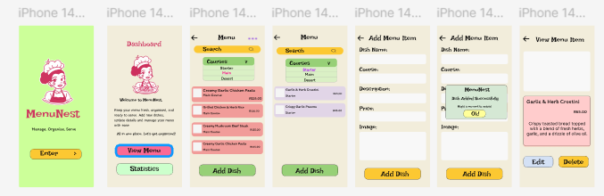

#  MenuNest
MenuNest is a menu management app built using **React Native, TypeScript**. The app allows for chef's to add dishes to a menu, organise them by course, view dish details, and upload an image for each dish.
# Author
Luyanda Mnisi 
ST10518910
## Features
### Splash Screen
- MenuNest logo 
- A "Enter" button to enter the app 
### Dashboard
- Welcome Screen 
- MenuNest Application intro
- Buttons for navigating to menu and stastics

### Menu 
- Displays dishes
- shows "No dish added" when the menu is empty 
- Course filtering:
  - Starter
  - Main
  -Dessert
- Different card colours for each course:
  - Starter: Lavender
  - Main: Coral/Pink
  - Dessert: Light Blue
- Scrollable dish list
- Each dish card can be pressed to view more details
- Add Dish button
### Add Menu Item
Users can add a new dish by entering:

- Dish Name
- Course
- Description
- Price
- Dish Image
When a dish is successfully added, a confirmation popup is displayed.
### View Menu Item
Users can view:

- Dish image
- Dish name
- Price
- Description

The screen also includes:

- Edit button
- Delete button
- Back navigation
## Application 

### Technologies Used

- React Native
- Expo
- TypeScript
- Expo Router
- Expo Image Picker
- Expo Font
## What Changed Since Part 2?
Since Part 2, I added a lot of cool new features and fixed bugs to make the app work smoothly. Here is a table showing all the changes I made and what I fixed during refactoring:

| Part / Feature | What I Changed & Fixed |
| :--- | :--- |
| **Dashboard Statistics Button** | I connected the Statistics button on the dashboard so that when I press it, it opens up the stats view smoothly. |
| **Statistics Screen Design** | I added a pastel blue background, a coral pink menu overview card, and light lavender information panels, with no emojis or messy icons. |
| **Real Menu Calculations** | I made sure the statistics screen reads real menu items from my app so it counts total items, average price in Rands, and items per course correctly. |
| **Navigation Fixes** | I fixed a bug where pressing back kept opening multiple menu screens. Now, pressing the back arrow takes me straight back to the dashboard. |
| **Unique Key Bug Fix** | I fixed an error where React got confused by duplicate dish keys by making sure every dish gets a unique ID when I add it. |
| **Code Refactoring** | I cleaned up my code, removed emojis, replaced them with clean text labels like Starter, Main, and Dessert, and organized everything nicely. |
# Links 
### YouTube
- [YouTube video](https://youtu.be/2EBxsVJ6YDE)
- Change quality to 1080p60
### GitHub
- [GitHub Link](https://github.com/luyandamnisi1010-beep/Chef-Menu_Manager.git)